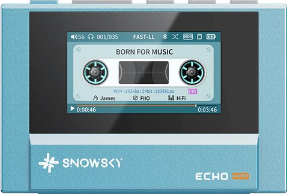

# Snowsky Echo Mini Emulator (`echo-mini-emu`)

A standalone desktop emulator and player for the **Snowsky Echo Mini** digital audio player. Built with native C and SDL2, featuring a photorealistic borderless hardware chassis, rotating tactile edge buttons, full Cover Flow album artwork rendering, and native Windows desktop integration.



---

## Features

- **Borderless Photorealistic Hardware Chassis**:
  - Borderless window (`SDL_WINDOW_BORDERLESS`) modeled on official hardware dimensions.
  - Native window dragging: click and grab anywhere on the metal chassis to move it across your desktop.
- **Dynamic 4-Way Rotating Edge Buttons**:
  - Clicking the `[ROTATE ↷]` button or pressing <kbd>R</kbd> smoothly rotates the casing $90^\circ$ clockwise ($0^\circ \rightarrow 90^\circ \rightarrow 180^\circ \rightarrow 270^\circ$).
  - Physical buttons stay attached to the rotating chassis:
    - **$0^\circ$ Landscape**: Top shoulder buttons (`POWER`, `VOL-`, `VOL+`, `PLAY`, `MENU`, `BACK`).
    - **$90^\circ$ Portrait**: Right flank buttons (`POWER`, `VOL-`, `VOL+`, `PLAY`, `MENU`, `BACK`).
    - **$180^\circ$ Inverted Landscape**: Bottom shoulder buttons (`BACK`, `MENU`, `PLAY`, `VOL+`, `VOL-`, `POWER`).
    - **$270^\circ$ Inverted Portrait**: Left flank buttons (`BACK`, `MENU`, `PLAY`, `VOL+`, `VOL-`, `POWER`).
- **Tactile Feedback & Active Power LED**:
  - Live button depression with beveled drop shadows.
  - Active Power LED illuminates glowing green when powered on, dimming to dark green in standby.
- **Standby & Soft Power-Off / Power-On**:
  - Holding the `POWER` button or <kbd>P</kbd> for ~2 seconds gracefully saves settings and enters standby (screen black, LED dark, emulator window stays open).
  - Holding `POWER` or <kbd>P</kbd> again while in standby boots the device back up with the animated boot splash.
- **Album Artwork Rendering**:
  - High-performance Cover Flow 3D carousel with perspective quad distortion, floor reflections, and light gradients.
  - Full album artwork box in Now Playing ($112 \times 112$).
- **Internal Storage Explorer Integration**:
  - Click `[FILES 📁]` or press <kbd>F</kbd> to open the emulator's `internal_storage` directory in Windows File Explorer.
  - Drop your audio files (`.flac`, `.mp3`, `.wav`, `.m4a`, `.opus`) directly into `internal_storage`.

---

## Quick Start (Prebuilt Release)

1. Download **`echo-mini-emu-v0.1-windows.zip`** from the [v0.1 Releases](https://github.com/tm9k1/echo-mini-emu/releases/tag/v0.1).
2. Extract the zip archive to any folder.
3. Drop your music files (`.flac`, `.mp3`, etc.) into the `internal_storage/` folder.
4. Double-click **`launch_echo_mini.vbs`** (silent launch) or **`run_echo_sim.bat`** to start the emulator.

---

## Controls

| Action | Mouse | Keyboard | Description |
| :--- | :--- | :--- | :--- |
| **Move Device** | Click & drag casing | — | Grab the casing body anywhere to move the window |
| **Power Off / Standby** | Press & hold `[POWER ⏻]` (~2s) | Hold <kbd>P</kbd> | Saves state, turns screen and LED off without closing window |
| **Power On** | Press & hold `[POWER ⏻]` (~0.8s) | Hold <kbd>P</kbd> | Turns screen on, illuminates LED, plays boot splash |
| **Backlight Sleep** | Tap `[POWER ⏻]` | Tap <kbd>P</kbd> | Toggles LCD backlight while device remains active |
| **Rotate 90° CW** | Click `[ROTATE ↷]` | <kbd>R</kbd> | Rotates casing 90° clockwise; buttons move to rotating edge |
| **Open Music Folder** | Click `[FILES 📁]` | <kbd>F</kbd> | Opens `internal_storage/` in Windows File Explorer |
| **Volume Up / Prev** | Click `[VOL -]` | <kbd>Up Arrow</kbd> | Decreases volume or moves menu selection up |
| **Volume Down / Next** | Click `[VOL +]` | <kbd>Down Arrow</kbd> | Increases volume or moves menu selection down |
| **Play / Pause / Select** | Click `[PLAY ▶‖]` | <kbd>Enter</kbd> / <kbd>Space</kbd> | Plays/pauses track or selects highlighted item |
| **Menu / Options** | Click `[MENU ≡]` | <kbd>M</kbd> / <kbd>Tab</kbd> | Opens contextual menu |
| **Back / Return** | Click `[BACK ↩]` | <kbd>Backspace</kbd> / <kbd>Esc</kbd> | Returns to previous screen / home |
| **Close Window** | Click `[✕]` | — | Exits the emulator process |

---

## Directory Structure

```
echo-mini-emu/
├── echo_sim.exe            # Native C emulator binary
├── SDL2.dll                # SDL2 runtime library
├── echo_mini.ico           # Hardware icon (16x16 to 256x256)
├── launch_echo_mini.vbs    # Windowless silent launcher
├── run_echo_sim.bat        # Batch launcher with diagnostic console
├── assets/
│   └── casing/
│       └── echo_mini_casing.bmp   # High-resolution photorealistic chassis
└── internal_storage/       # Drag-and-drop your music files here
    └── .echo/              # Audio database and cover cache
```

---

## License

Firmware and emulation engine licensed under the Apache License 2.0.
All trademarks and hardware designs belong to Snowsky.
